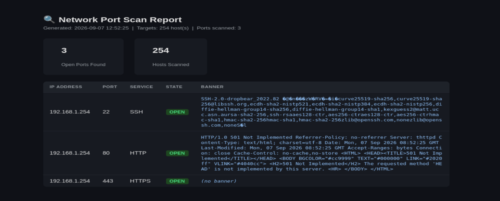

# Port & Banner Grabber Scanner

A Python scanner that checks TCP ports concurrently, reads service banners, guesses service names and versions, and writes JSON plus a dark-themed HTML report.

> **Use only against hosts you own or have explicit permission to scan.** Unauthorized scanning may be illegal in your jurisdiction.



---

## Features

- **Async TCP connect scan** — `asyncio` workers scan many ports at once
- **Banner grabbing** — reads SSH, FTP, SMTP, IMAP, and POP banners, and sends a short HTTP or Redis identification probe when the service stays silent
- **Service hints** — maps well-known ports and, when a banner is present, extracts products and versions such as OpenSSH, nginx, Apache, vsftpd, and Postfix
- **JSON export** — machine-readable results, including timing and outcome counts
- **HTML report** — Bootstrap 5 dark layout with a summary dashboard and a color-coded results table
- **Structured logging** — timeouts and refused connections are counted quietly; use `-v` to see each one
- **`--common` flag** — scan a built-in set of well-known ports instead of a range

## Requirements

- Python 3.10+
- No external packages — the scanner uses the Python standard library. The HTML report loads Bootstrap 5 from a CDN when you open it.

## Installation

```bash
git clone https://github.com/umidguluzada/network-scanner.git
cd network-scanner
```

No install step is required.

## Usage

```bash
# Single host, explicit ports
python port_scanner.py -t 192.168.1.10 -p 22,80,443

# Port range, shorter timeout, HTML report
python port_scanner.py -t 192.168.1.10 -p 1-1024 -to 0.8 --html -o scan.json

# Hostname, well-known ports, keep the report from opening automatically
python port_scanner.py -t localhost --common --html --no-open

# CIDR, comma-separated hosts still work
python port_scanner.py -t 192.168.1.10,192.168.1.20 --common -o scan.json

# Show timeouts and refused connections while scanning
python port_scanner.py -t 192.168.1.10 -p 1-200 -to 0.5 -v
```

`-t` / `--target` also accepts the older `--targets` name.

## Arguments

| Flag | Description |
|---|---|
| `-t`, `--target` | **(required)** IP, hostname, CIDR (`192.168.1.0/24`), or a comma-separated list |
| `-p`, `--ports` | Ports such as `22,80,443` or `1-1000` (default: `1-1024`) |
| `-to`, `--timeout` | Per-connection timeout in seconds (default: `1.5`) |
| `--common` | Scan the built-in well-known port set instead of a range |
| `-o`, `--output` | JSON output path (default: `scan_results.json`) |
| `-w`, `--workers` | Maximum concurrent connections (default: `300`) |
| `--html` | Also write a Bootstrap HTML report next to the JSON file |
| `--no-open` | Do not open the HTML report in a browser |
| `-v`, `--verbose` | Log each timeout, refusal, and other debug detail |

CIDR ranges larger than 65,536 hosts are rejected. IPv6 targets are not supported.

## Example output

```
20:54:01 INFO    Resolved localhost -> 127.0.0.1
20:54:01 INFO    Scanning 1 host(s), 3 port(s), timeout 1.50s, concurrency 3 (3 checks)
20:54:01 INFO    OPEN 127.0.0.1:22 SSH OpenSSH 8.9p1 - SSH-2.0-OpenSSH_8.9p1
20:54:01 INFO    Scan complete in 0.42s - 1 open, 2 connection refused, 0 timed out, 0 errors
20:54:01 INFO    JSON saved to scan.json
20:54:01 INFO    HTML report saved to scan.html
```

Refused connections and timeouts are normal scan results. They are included in the summary and in the HTML dashboard. Unresolved hostnames are logged as errors and skipped. On Windows, a firewall may drop packets to closed ports, so those ports show up as "no response" instead of "connection refused".

## Service detection

The scanner reports a service in one of three ways:

- **banner** — the service spoke first (typical for SSH, FTP, and SMTP) and the text matched a known pattern
- **probe** — the port stayed silent, and a harmless HTTP `HEAD`/`GET` or Redis `PING` produced a reply
- **port** — nothing came back, so the name is only the well-known port guess and confidence stays low

A matching banner overrides the port guess. Version strings are best-effort and are not a vulnerability assessment.

## Project structure

```
network-scanner/
├── port_scanner.py     # Scanner, service hints, JSON + HTML report
├── README.md
├── LICENSE
├── .gitignore
└── docs/
    └── html-report.png
```

Scan output (`*.json`, `*.html`) is gitignored. Each run writes fresh results for the hosts you scanned.

## License

This project is licensed under the [MIT License](LICENSE).
